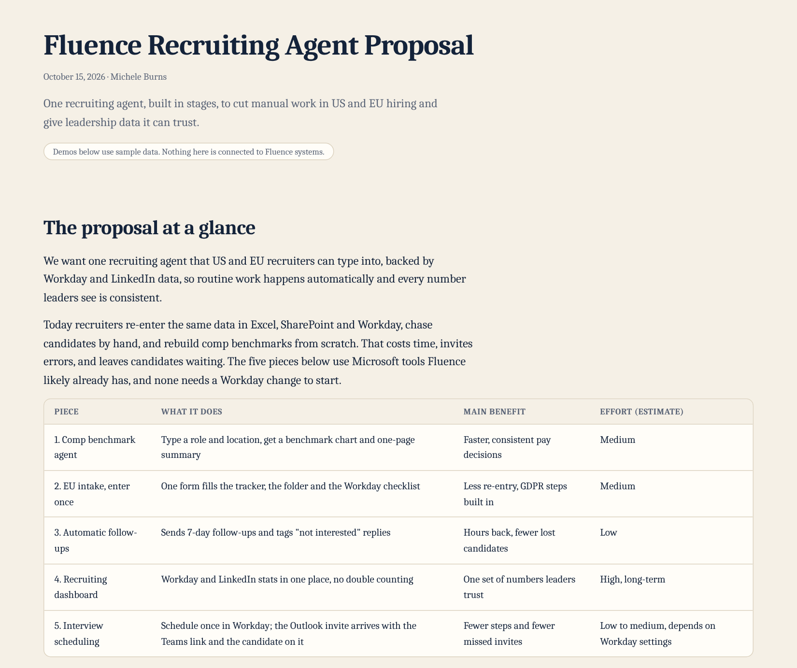
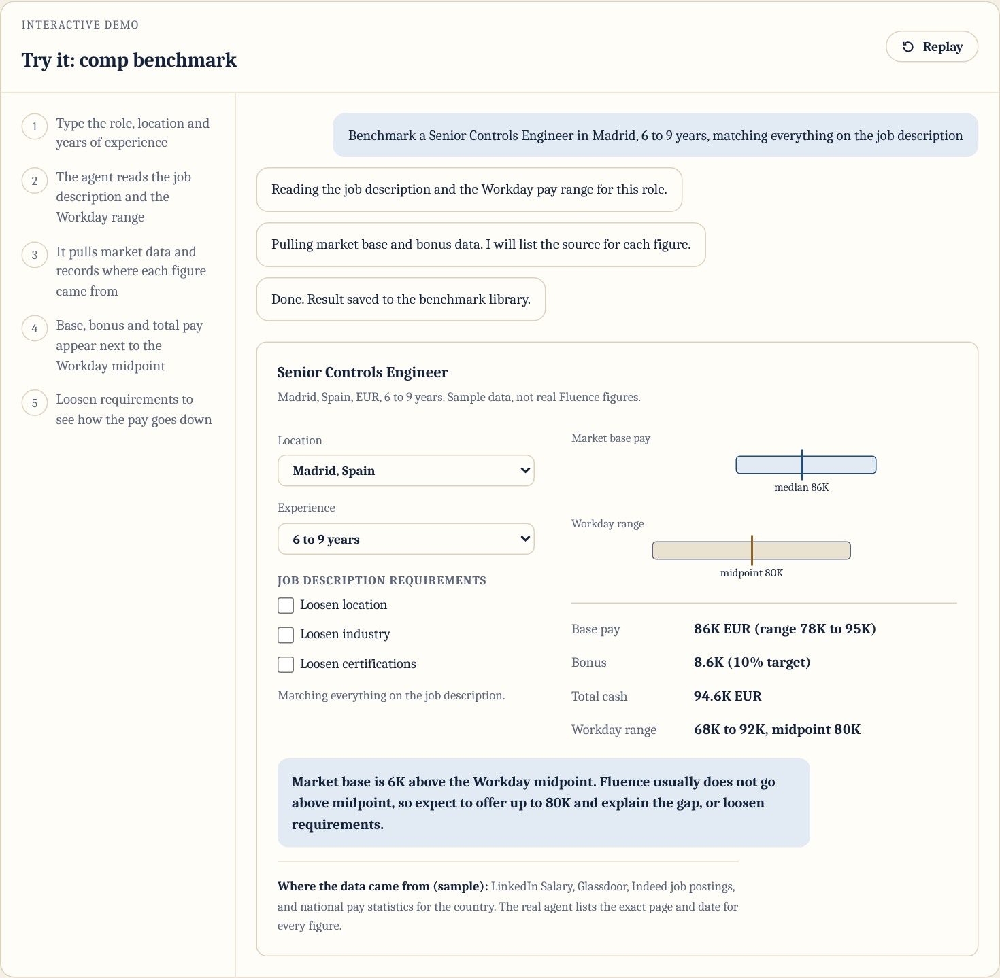
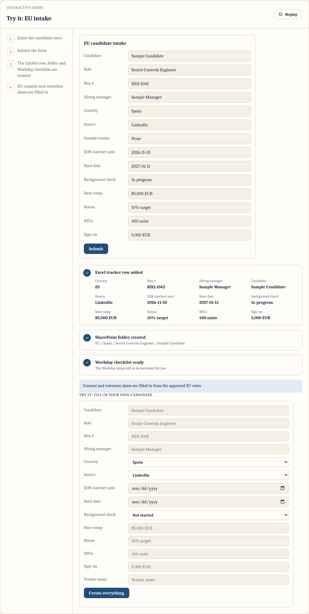
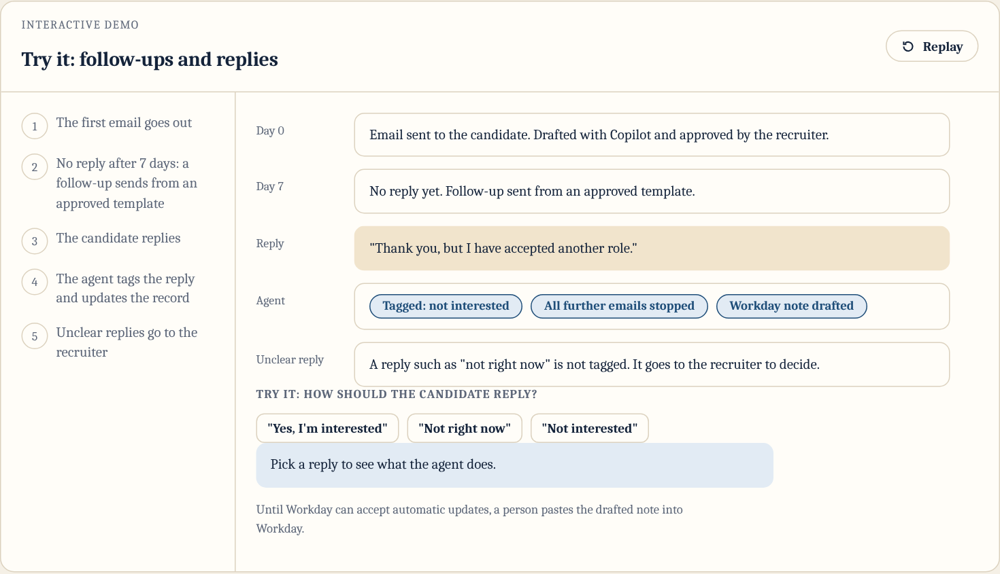
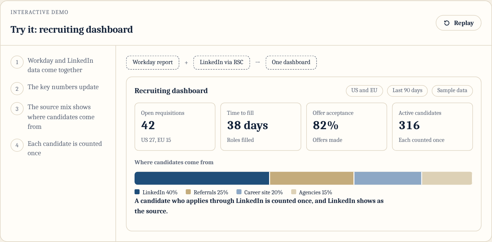
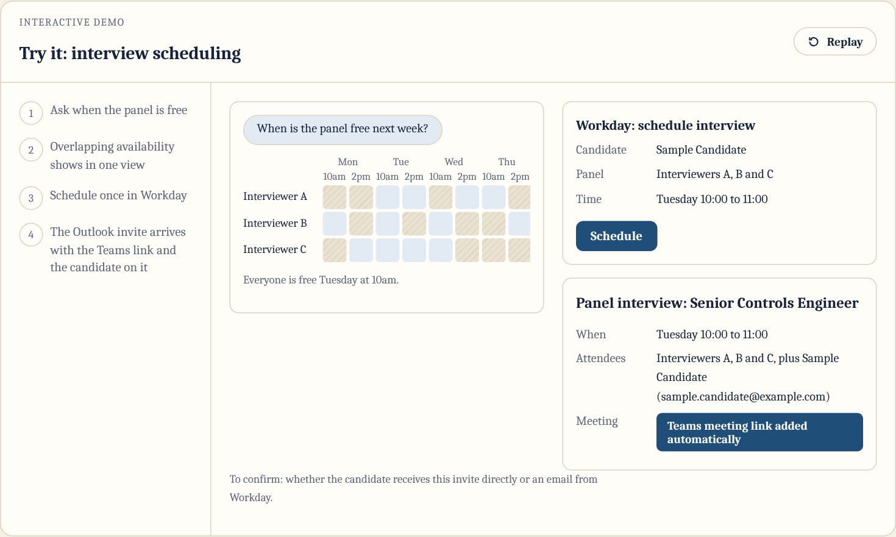

# Fluence Recruiting Agent Proposal

A single-page proposal for a recruiting agent that cuts manual work in US and EU hiring and gives leadership one consistent set of numbers.

Prepared by Michele Burns, October 15, 2026.

**Live page:** https://micheleburns74-prog.github.io/fluence-recruiting-proposal/

## What the proposal covers

### 1. Comp benchmark agent

Type a role and location and get a benchmark chart and one-page summary, with the Workday midpoint shown next to market pay.

### 2. EU intake, enter once

One short form creates the tracker row, the SharePoint folder and the Workday checklist, with EU consent and retention dates built in.

### 3. Automatic follow-ups and reply handling

A follow-up goes out after 7 days of silence, and "not interested" replies are tagged and stop further emails.

### 4. Recruiting dashboard (long-term)

Workday and LinkedIn stats in one place, with each candidate counted once.

### 5. Interview scheduling in one step

Schedule once in Workday and the Outlook invite arrives with the Teams link and the candidate on it.

The page also includes expected results, a phased rollout and a table of questions to answer before building.

## What is in this repository

- `index.html`: the full proposal as one self-contained web page. No build step.
- `images/`: preview screenshots used in this README.
- `README.md`: this file.

## Notes

- All demos use sample data. Nothing on the page is connected to Fluence systems.
- The page is a proposal and does not contain real Fluence data or candidate information.
